<!-- Profile README for kenji0011 (Kean Gabriel Salvahan) -->

  <picture>
    <source media="(prefers-color-scheme: dark)" srcset="./assets/hero-dark.svg" />
    <source media="(prefers-color-scheme: light)" srcset="./assets/hero-light.svg" />
    
  </picture>

  
  
  
  

### About

Intelligent Systems Computer Science student based in Laguna, Philippines, specializing in **Data Analytics** with a growing focus on **Quality Assurance** and **Workflow Automation**. I audit relational data integrity, build full-stack and offline-first applications, and am currently open to **On-the-Job Training (OJT)** roles.

| Focus | Scope | Primary Tools |
| :--- | :--- | :--- |
| **Data Analytics** | Querying relational datasets, auditing data integrity, and building reporting dashboards | `SQL` `PostgreSQL` `Pandas` |
| **Quality Assurance** | Structured test case design, system workflow analysis, and software reliability | `Manual QA` `API Testing` `Postman` |
| **Automation** | Eliminating repetitive manual checks with scripted test suites and CI pipelines | `PyTest` `Selenium` `Python` `GitHub Actions` |

  <picture>
    <source media="(prefers-color-scheme: dark)" srcset="./assets/divider-dark.svg" />
    <source media="(prefers-color-scheme: light)" srcset="./assets/divider-light.svg" />
    
  </picture>

### Selected Work

| Project | Summary | Stack | Links |
| :--- | :--- | :--- | :--- |
| **Tempo** | 100% offline-first personal fitness tracker powered by an embedded Rust + SQLite native core over `dart:ffi`, with SHA-256 salted PIN profiles. | `Flutter` `Rust` `SQLite` | [Repo](https://github.com/kenji0011/fitness-tracker-v2) / [Release](https://github.com/kenji0011/fitness-tracker-v2/releases/latest) |
| **Berong E-Learning (SafeScape 2.0)** | Interactive web-based e-learning platform with structured course modules, progress tracking, and multi-audience dashboards. | `Laravel` `PHP` `PostgreSQL` `Tailwind` | [Repo](https://github.com/kenji0011/berong-safescape-laravel) / [Live](https://bfpscberong.app) |
| **Medical Center Bank** | Inventory optimization web application applying Monte Carlo simulation to determine optimal reorder points. | `Next.js` `TypeScript` `Tailwind` | [Repo](https://github.com/kenji0011/Inventory-System-Project) |
| **Kasangkap-Hunt Chefbot** | NLP-driven Filipino recipe chatbot supporting natural-language ingredient queries and intent classification. | `Python` `TensorFlow` `Pandas` | [Repo](https://github.com/kenji0011/Chefbot_KasangKap-Hunt) |

### Tech Stack

| Category | Technologies |
| :--- | :--- |
| **Data & Analytics** |         |
| **QA & Automation** |     |
| **Web & Mobile** |         |
| **Systems & Tools** |        |

### Credentials

- **IT Specialist — Data Analytics** — Certiport (Pearson VUE) · [Verify](https://www.credly.com/badges/7b325661-ef72-42ce-b7da-f942473c9273/public_url)
- **TOPCIT** — Institute of Information & Communications Technology Planning & Evaluation (IITP)
- **Google AI & ML Micro-Credentials** — Agent Fundamentals, Generative AI, PMLE Study Guide · [Profile](https://www.skills.google/public_profiles/b1f37c59-8b3b-49db-8249-d692905fa6d9)

  <picture>
    <source media="(prefers-color-scheme: dark)" srcset="./assets/divider-dark.svg" />
    <source media="(prefers-color-scheme: light)" srcset="./assets/divider-light.svg" />
    
  </picture>

### Contribution Activity

  <picture>
    <source media="(prefers-color-scheme: dark)" srcset="https://raw.githubusercontent.com/kenji0011/kenji0011/output/github-snake-dark.svg" />
    <source media="(prefers-color-scheme: light)" srcset="https://raw.githubusercontent.com/kenji0011/kenji0011/output/github-snake-light.svg" />
    
  </picture>

